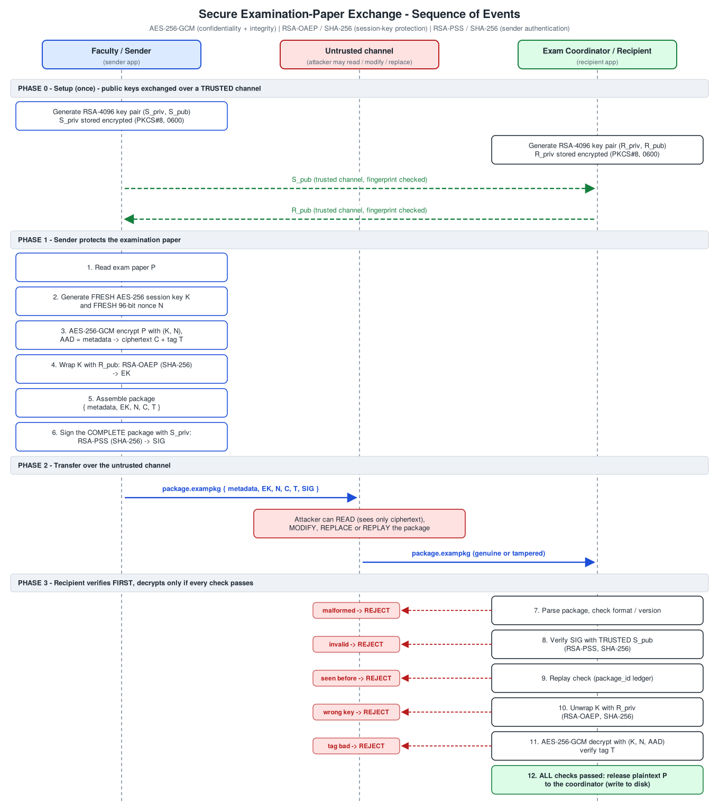

# Secure Examination-Paper Exchange (Python)

A faculty member (sender) sends a confidential exam paper to the examination coordinator
(recipient) over a channel an attacker can read, modify or replace. The application gives
**confidentiality**, **integrity** and **sender authentication**, using only the established
[`cryptography`](https://cryptography.io) library (no home-made primitives).

## Files

| File | Purpose |
|---|---|
| `secure_exam.py` | The application: key generation, encryption + signing, verification + decryption, CLI |
| `run_demo.py` | Simulation (separate `sender/`, `recipient/`, `attacker/`, `channel/` folders) and all tests |
| `make_sequence_diagram.py` | Generates `sequence_diagram.svg` |
| `sequence_diagram.svg` / `.png` | Sequence-of-events diagram |
| `test_results.txt` | Full output of the last test run (18/18 checks passed) |
| `simulation/` | Sample input, keys, encrypted packages, tampered packages, recovered file |

## Run it

```bash
pip install cryptography
python run_demo.py          # builds ./simulation and writes test_results.txt
```

Command-line use (passphrase from `EXAM_KEY_PASSPHRASE` or an echo-free prompt):

```bash
python secure_exam.py keygen  --name sender    --out-dir sender/keys
python secure_exam.py keygen  --name recipient --out-dir recipient/keys
python secure_exam.py encrypt --input paper.txt --output paper.exampkg \
      --sender-private sender/keys/sender_private.pem \
      --recipient-public sender/trusted/recipient_public.pem
python secure_exam.py decrypt --package paper.exampkg --out-dir recipient/decrypted \
      --recipient-private recipient/keys/recipient_private.pem \
      --sender-public recipient/trusted/sender_public.pem --ledger recipient/ledger.json
```

Exit code `0` = accepted, `2` = rejected (a clear `REJECTED [...]` message is printed and **no plaintext is written**).

## Design

| Requirement | Implementation |
|---|---|
| Large keys | RSA-**4096** for sender and recipient (anything under 3072 bits is refused when loading) |
| Key storage | Private keys: PKCS#8 PEM, passphrase-encrypted, file mode `0600`. Public keys: PEM |
| File encryption | Fresh random **AES-256** session key and fresh random **96-bit nonce** per encryption, **AES-256-GCM** |
| Session-key protection | **RSA-OAEP**, MGF1-SHA256, hash SHA-256, with the recipient's public key |
| Digital signature | **RSA-PSS**, MGF1-SHA256, SHA-256, 32-byte salt, over the *complete* package |
| Order of checks | parse → verify signature → replay check → unwrap key (OAEP) → verify GCM tag → release plaintext |
| Failure handling | Typed exceptions (`SignatureVerificationError`, `SessionKeyError`, `IntegrityError`, `ReplayError`, `KeyLoadError`, `PackageFormatError`); plaintext only exists after every check passed |

**Package (`.exampkg`, JSON)**: `format`, `version`, `metadata` (package_id, created_utc,
original_filename, plaintext_size, sender/recipient key fingerprints, algorithm suite),
`encrypted_session_key`, `nonce`, `ciphertext`, `tag`, `signature` (binary fields base64).
The signature covers the canonical JSON of **every field except `signature`**; unknown or
missing fields are rejected. The metadata is *also* the GCM AAD, so it is protected twice.

## Sequence of events




## How the three security properties are provided

**Confidentiality.** The paper is encrypted with AES-256-GCM under a one-time random key that is
itself encrypted with the recipient's RSA public key. Only the holder of the recipient's private
key can recover the session key, so someone reading the channel sees only ciphertext (test T1
confirms no exam text appears in the package; T3 shows a wrong private key gets nothing). A new
key and nonce per encryption means the same paper never produces the same ciphertext (T5) and
GCM's key/nonce-reuse weakness is avoided.

**Integrity.** Two independent layers detect modification. (1) The RSA-PSS signature covers the
whole package, so changing *any* byte of ciphertext, tag, nonce, wrapped key, metadata or the
signature itself is detected before anything is decrypted (T2a-T2g). (2) AES-GCM's authentication
tag covers the ciphertext and, through the AAD, the metadata, so tampering is still caught even if
the signature check were bypassed (T2i, T2j). Plaintext is never released unless both pass.

**Sender authentication.** Only the holder of the sender's private key can produce a signature that
verifies under the sender's public key, which the recipient obtained over a trusted channel. An
attacker who builds a perfectly valid package of their own (encrypted to the recipient's public
key, signed with their own key) is rejected (T2h), as is verification against the wrong public key
(T4). Verifying the signature *before* any RSA decryption also means an unauthenticated attacker
cannot feed crafted ciphertexts into the OAEP decryption step.

## Test results (from `test_results.txt`, 18/18 passed)

| ID | Scenario | Outcome |
|---|---|---|
| T0 | Key generation, storage | 3 separate RSA-4096 pairs, private keys encrypted, mode 0600 |
| T1 | Authorised recipient decrypts | Recovered file byte-identical (same SHA-256); exam text not visible in package |
| T2a | 1 bit of ciphertext flipped | Rejected: `SignatureVerificationError` |
| T2b, T2c | Metadata edited (filename, timestamp) | Rejected: `SignatureVerificationError` |
| T2d | 1 bit of signature flipped | Rejected: `SignatureVerificationError` |
| T2e, T2f, T2g | Wrapped key / nonce / GCM tag flipped | Rejected: `SignatureVerificationError` |
| T2h | Attacker replaces package with own validly-formed, self-signed one | Rejected: `SignatureVerificationError` |
| T2i, T2j | GCM layer alone (signature check bypassed): ciphertext flip, metadata edit | Rejected: `IntegrityError` (tag / AAD) |
| T3a | Wrong recipient private key | Rejected: `SessionKeyError` (OAEP fails, error names the fingerprint mismatch) |
| T3b | Right key file, wrong passphrase | Rejected: `KeyLoadError` |
| T4 | Wrong sender public key | Rejected: `SignatureVerificationError` |
| T5 | Same file encrypted twice | Nonce, wrapped key, ciphertext, tag, signature and package hash all differ; both decrypt to the original |
| T6 | Replay of an already-accepted package | Rejected: `ReplayError` |
| T7 | Output folder for failed attempts | Empty: no plaintext ever written by a rejected package |

## Limitations and notes

- Public keys are assumed to be exchanged over a trusted channel (as specified). There is no PKI,
  expiry or revocation; compare `python secure_exam.py fingerprint` values out-of-band when exchanging keys.
- Metadata (file name, size, timestamp, key fingerprints) is authenticated but **not** encrypted.
- The replay ledger is local to the recipient's machine. Delete it and a genuine old package can be accepted again.
- Strength of private-key protection depends on the passphrase. The demo passphrases in `run_demo.py` are for the
  simulation only; the demo keys in `simulation/` must never be reused.
- The whole file is processed in memory (suitable for exam papers, not multi-GB files).
- Python cannot guarantee that key material is wiped from memory after use.
